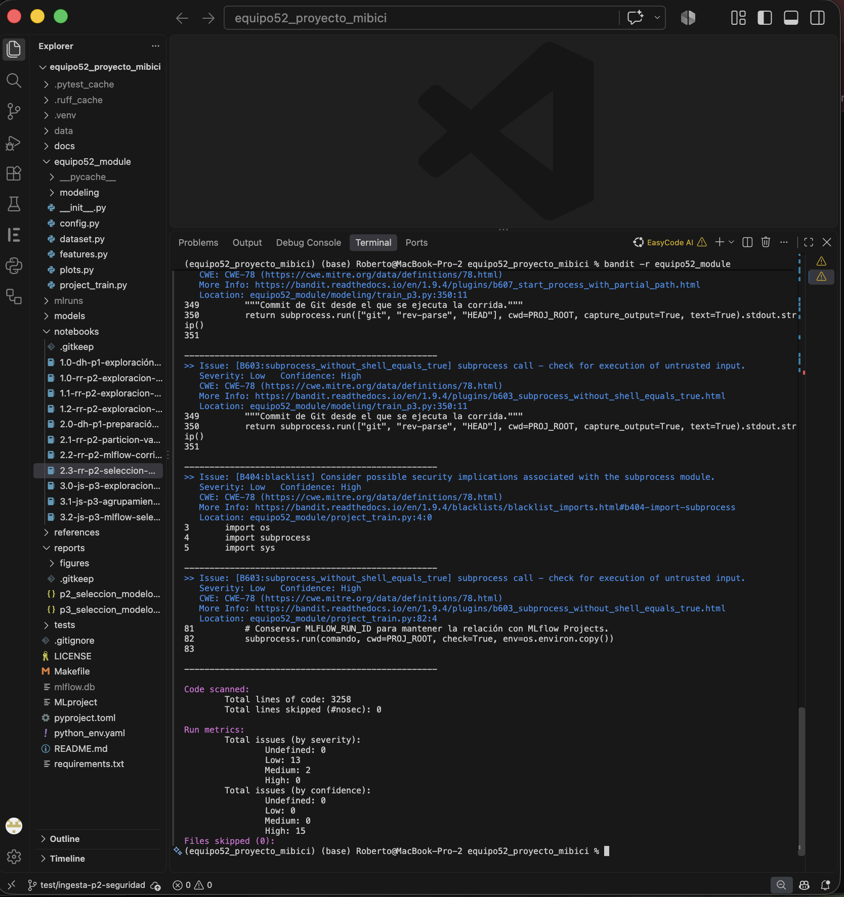
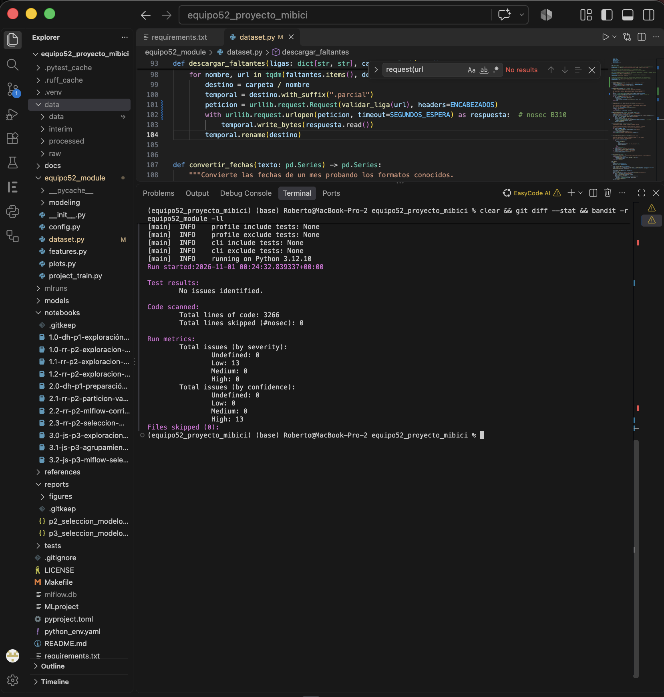
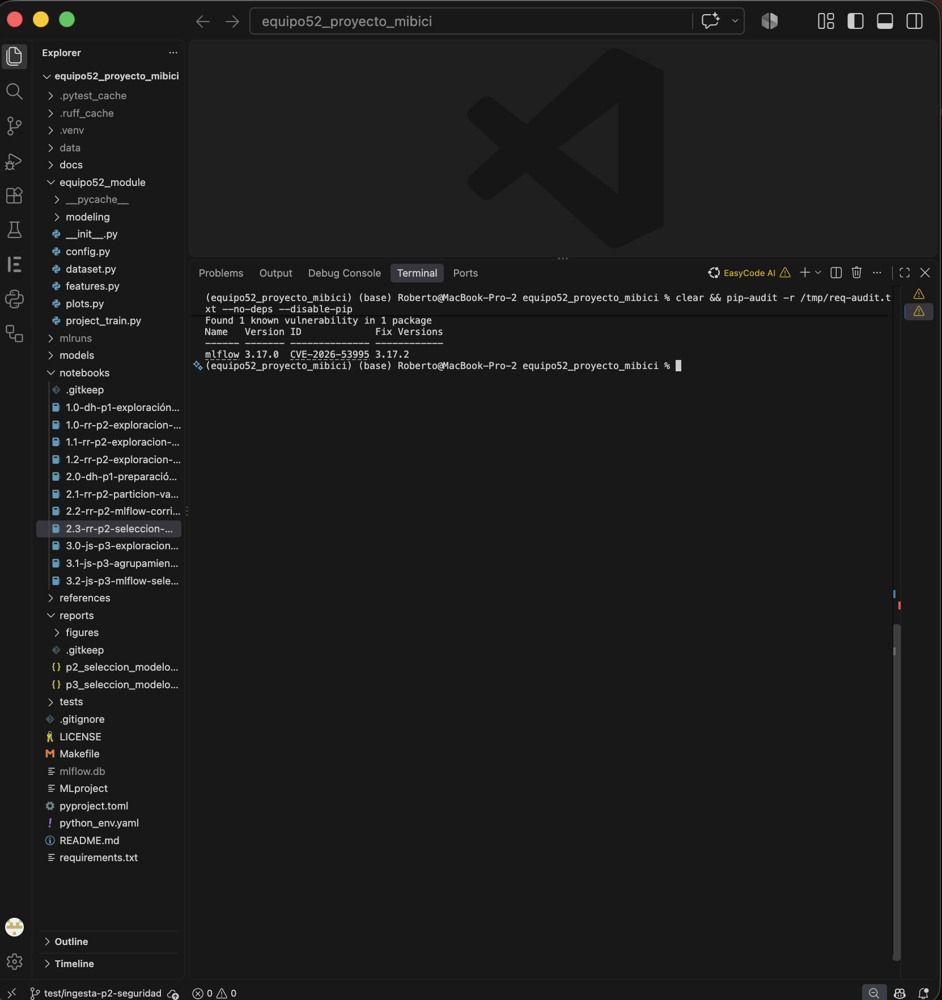
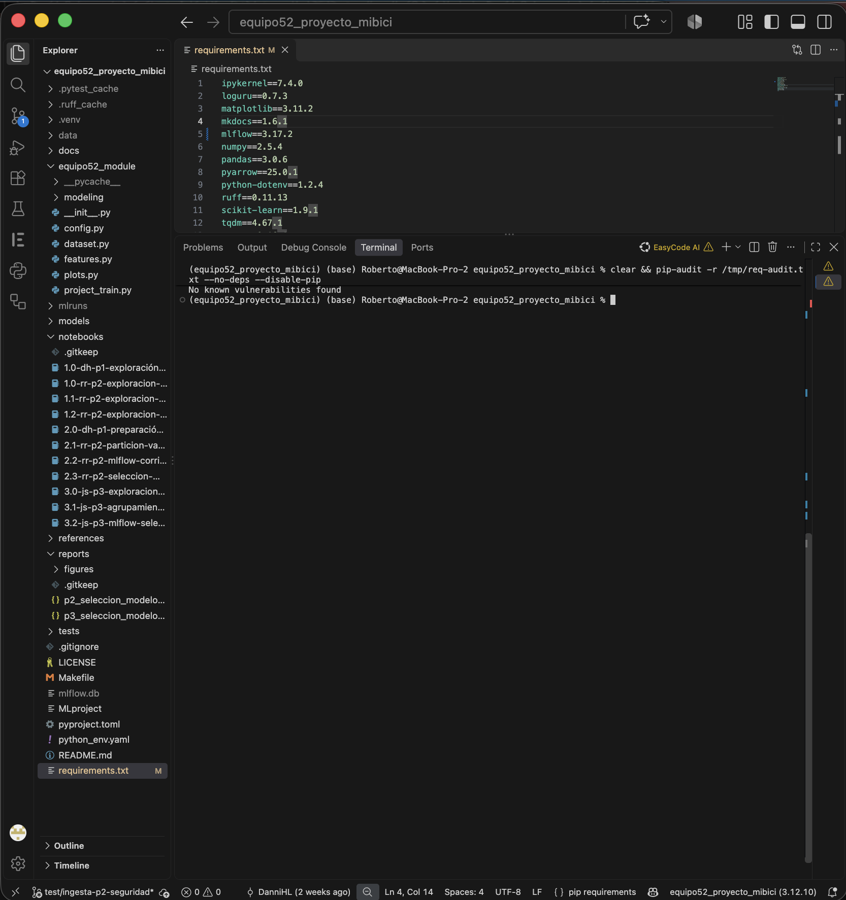
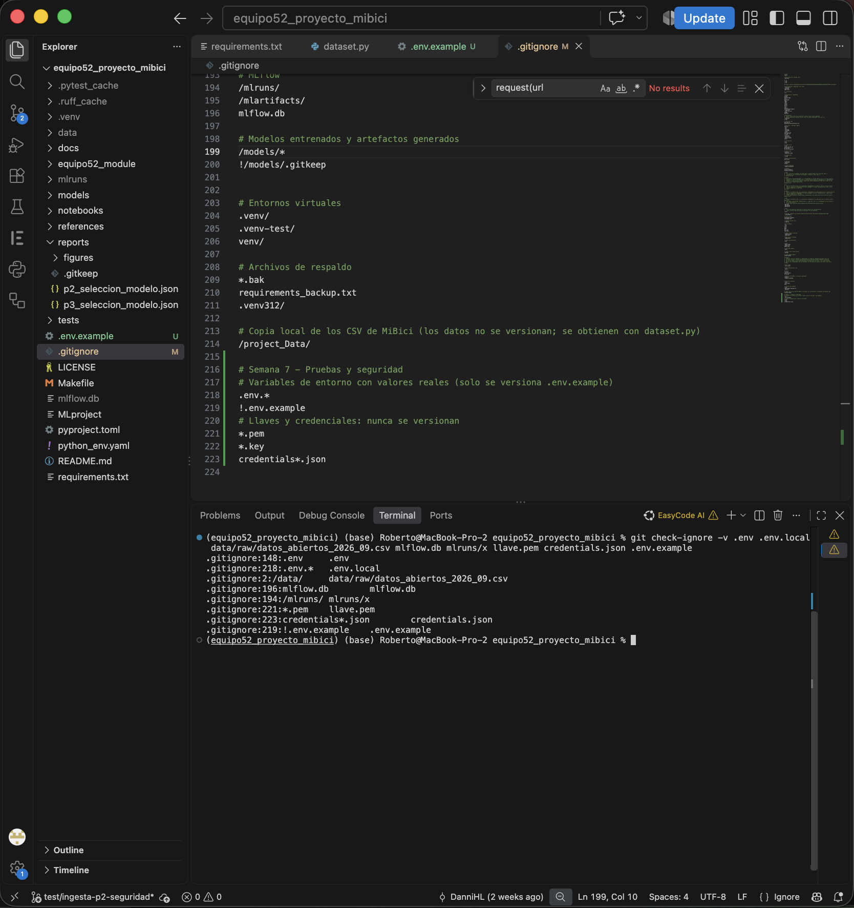
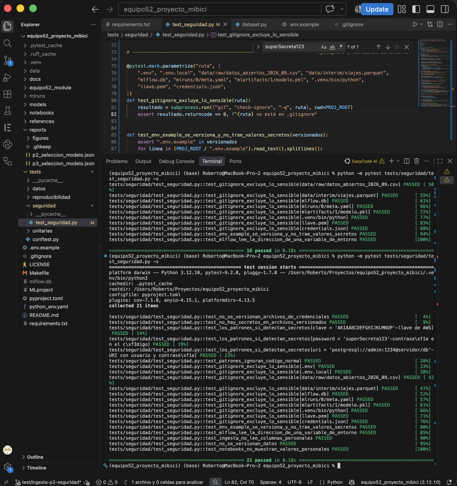

# TC5061 · Proyecto MiBici · Equipo 52

Proyecto de Machine Learning Operations (MLOps) para analizar los viajes del sistema público de bicicletas **MiBici**, del Área Metropolitana de Guadalajara, y desarrollar modelos de aprendizaje automático para responder tres preguntas de negocio.

El proyecto integra un flujo de trabajo que contempla la obtención y preparación de datos, el desarrollo de modelos, la ejecución de experimentos, la evaluación de resultados y el registro de modelos mediante MLflow. También incorpora pruebas automatizadas para verificar el funcionamiento de los componentes del proyecto.

---

## 1. Descripción del proyecto

MiBici es el sistema de bicicletas públicas del Área Metropolitana de Guadalajara. A través de sus datos abiertos es posible analizar los viajes realizados por los usuarios, identificar patrones de movilidad y estudiar el comportamiento de las estaciones.

El objetivo del proyecto es utilizar estos datos para desarrollar soluciones de Machine Learning que permitan analizar la demanda, anticipar situaciones de riesgo operativo y agrupar estaciones según sus patrones de uso.

El equipo trabaja con tres preguntas:

| Pregunta | Objetivo | Responsable |
|---|---|---|
| P1 | Analizar y pronosticar la demanda diaria de viajes por estación. | Danni |
| P2 | Identificar y anticipar situaciones de riesgo relacionadas con la disponibilidad de bicicletas y anclajes. | Roberto |
| P3 | Identificar grupos de estaciones con patrones de comportamiento similares. | Joel |

Los tres modelos utilizan una fuente de datos común y comparten la infraestructura de experimentación y seguimiento de MLflow.

## 2. Fuente de datos

Los datos utilizados provienen del portal de datos abiertos de MiBici:

- Datos históricos de viajes: archivos mensuales `datos_abiertos_AAAA_MM.csv`.
- Catálogo de estaciones: archivo `nomenclatura_2026_09.csv`.

Los archivos de viajes contienen información sobre los recorridos realizados, incluyendo identificador del viaje, fechas y horas de inicio y finalización, así como las estaciones de origen y destino.

El catálogo de estaciones contiene información de identificación, nombre, ubicación geográfica y capacidad de las estaciones.

### 2.1 Periodo de análisis

El periodo considerado comprende del **1 de diciembre de 2014 al 30 de septiembre de 2026**.

| Elemento | Descripción |
|---|---|
| Inicio del periodo | 2014-12-01 |
| Fin del periodo | 2026-09-30 |
| Versión de datos | 2026-09 |
| Archivos mensuales | 142 |
| Registros de viajes | 39,078,984 |
| Tamaño aproximado de los datos | 3.1 GB |
| Catálogo de estaciones | `nomenclatura_2026_09.csv` |

### 2.2 Consideraciones sobre los datos

Durante la preparación se identificaron diferencias entre los archivos históricos, principalmente en los nombres de columnas y formatos de fechas. Por esta razón, el proceso de ingesta contempla la normalización de los datos antes de utilizarlos en los modelos.

También se identificaron las siguientes condiciones:

- Existen 14 estaciones excluidas de los análisis por los criterios definidos para el proyecto.
- Las estaciones 124, 405 y 407 no cuentan con correspondencia en el catálogo de nomenclatura utilizado.
- Durante 2026 se incorporaron 100 estaciones nuevas, por lo que su disponibilidad de información histórica debe considerarse al construir las variables de los modelos.

Los datos originales y procesados no se incluyen en el repositorio debido a su tamaño. Se generan localmente mediante el proceso de ingesta.

## 3. Estructura del proyecto

El repositorio se organiza de la siguiente manera:

```text
El repositorio está organizado para separar la ingesta y preparación de datos, el desarrollo de los modelos de Machine Learning, la API de inferencia, las pruebas y los elementos necesarios para su despliegue.

```text
equipo52_proyecto_mibici/
│
├── api/
│   ├── main.py
│   ├── routers/
│   │   ├── p1.py
│   │   ├── p2.py
│   │   └── p3.py
│   ├── schemas/
│   │   ├── p1.py
│   │   ├── p2.py
│   │   └── p3.py
│   └── services/
│       ├── p1.py
│       ├── p2.py
│       └── p3.py
│
├── data/
│   └── ...
│
├── docs/
│   └── ...
│
├── equipo52_module/
│   └── ...
│
├── models/
│   ├── p1/
│   │   └── ...
│   ├── p2/
│   │   └── ...
│   └── p3/
│       └── ...
│
├── notebooks/
│   └── ...
│
├── project_Data/
│   └── ...
│
├── references/
│   └── ...
│
├── reports/
│   ├── figures/
│   │   └── ...
│   └── calidad/
│       └── ...
│
├── tests/
│   ├── unitarias/
│   │   └── ...
│   ├── reproducibilidad/
│   │   └── ...
│   ├── seguridad/
│   │   └── ...
│   └── datos/
│       └── ...
│
├── .env.example
├── .gitignore
├── Dockerfile
├── Makefile
├── README.md
├── pyproject.toml
└── requirements.txt
```


### 3.1 Organización de carpetas

| Carpeta | Propósito |
|---|---|
| `api/` | Implementación de la API REST con FastAPI para consultar los modelos P1, P2 y P3. |
| `api/routers/` | Endpoints para recibir solicitudes de predicción de cada modelo. |
| `api/schemas/` | Esquemas Pydantic para validar los datos de entrada y salida de la API. |
| `api/services/` | Servicios para cargar los modelos y generar predicciones. |
| `data/` | Datos originales y procesados utilizados durante el desarrollo del proyecto. |
| `docs/` | Documentación técnica del proyecto. |
| `equipo52_module/` | Código fuente del proyecto. |
| `equipo52_module/modeling/` | Scripts de preparación, entrenamiento y evaluación de los modelos P1, P2 y P3. |
| `models/` | Modelos entrenados y artefactos necesarios para ejecutar la API; sus archivos se versionan en Git. |
| `notebooks/` | Análisis exploratorio y experimentación. |
| `project_Data/` | Copia local de los archivos CSV de MiBici obtenidos mediante el proceso de descarga. |
| `references/` | Manifiestos y referencias de los datos utilizados. |
| `reports/figures/` | Gráficas y resultados visuales generados durante el análisis y evaluación de los modelos. |
| `reports/calidad/` | Reportes de validación y calidad de los datos. |
| `tests/` | Pruebas automatizadas y validaciones del proyecto. |
| `tests/unitarias/` | Pruebas unitarias de los componentes de ingesta, preparación y entrenamiento. |
| `tests/reproducibilidad/` | Pruebas para verificar la reproducibilidad de los resultados. |
| `tests/seguridad/` | Pruebas relacionadas con la gestión de secretos, credenciales y archivos sensibles. |
| `tests/datos/` | Pruebas de calidad y validación de datos mediante DeepChecks.

Los datos y artefactos generados localmente no se incorporan al control de versiones cuando están excluidos mediante `.gitignore`.

## 4. Tecnologías utilizadas

| Tecnología | Uso dentro del proyecto |
|---|---|
| Python 3.12 | Lenguaje de programación. |
| Pandas | Lectura, transformación y análisis de datos. |
| NumPy | Operaciones numéricas. |
| Scikit-learn | Desarrollo y evaluación de modelos. |
| PyArrow | Lectura y escritura de archivos Parquet. |
| Matplotlib | Generación de gráficas. |
| MLflow 3.17.2 | Seguimiento de experimentos y registro de modelos. |
| Pytest | Ejecución de pruebas automatizadas. |
| Ruff | Revisión y organización del código. |
| Python-dotenv | Manejo de variables de entorno. |
| Typer | Interfaz de comandos. |
| Loguru | Registro de eventos y mensajes. |

## 5. Instalación y configuración del entorno

### 5.1 Requisitos previos

- Python 3.12.
- Git.
- Acceso al repositorio de GitHub.
- Un entorno virtual de Python.

### 5.2 Clonar el repositorio

```bash
git clone https://github.com/DanniHL/TC5061-Proyecto-Equipo52.git
```

Ingresar a la carpeta:

```bash
cd TC5061-Proyecto-Equipo52
```

### 5.3 Crear y activar el entorno virtual

En Windows PowerShell:

```powershell
python -m venv .venv312
```

Activar el entorno:

```powershell
.\.venv312\Scripts\Activate.ps1
```

En macOS o Linux:

```bash
python3 -m venv .venv
source .venv/bin/activate
```

### 5.4 Instalar las dependencias

Actualizar pip:

```bash
python -m pip install --upgrade pip
```

Instalar las dependencias del proyecto:

```bash
python -m pip install -r requirements.txt
```

El archivo `requirements.txt` contiene las versiones de las bibliotecas utilizadas, incluyendo MLflow 3.17.2 y Pytest.

### 5.5 Verificar la instalación

```bash
python --version
python -m pip check
```

Consultar las versiones principales:

```bash
python -m pip show mlflow pytest pandas scikit-learn
```

## 6. Ingesta y preparación de datos

La ingesta se realiza mediante el módulo `dataset.py`, encargado de obtener los archivos mensuales, normalizar su estructura y preparar los datos para su utilización en las tres preguntas del proyecto.

### 6.1 Ejecutar la ingesta

Desde la raíz del repositorio:

```bash
python equipo52_module/dataset.py
```

El proceso obtiene los archivos históricos, realiza las transformaciones correspondientes y genera los datos preparados para los modelos.

### 6.2 Resultados de la ingesta

En la ejecución documentada se procesaron:

- 142 archivos mensuales.
- 39,078,984 registros de viajes.
- Periodo de diciembre de 2014 a septiembre de 2026.

Los datos se almacenan localmente y se genera un manifiesto para identificar la versión utilizada.

### 6.3 Manifiesto de datos

El archivo `references/manifiesto_datos.json` permite documentar la información correspondiente al conjunto de datos utilizado, incluyendo su versión, fuente, cantidad de registros y huella digital SHA256.

La huella permite comprobar si los archivos utilizados corresponden a la misma versión de datos entre diferentes ejecuciones.

El manifiesto también se utiliza como referencia para registrar la procedencia de los datos en los experimentos de MLflow.

## 7. Pregunta P1: Pronóstico de demanda diaria

### 7.1 Objetivo

Analizar el comportamiento de la demanda de viajes por estación y desarrollar un modelo que permita estimar la cantidad de viajes diarios.

La variable objetivo corresponde al número de viajes registrados por estación y día, considerando la estación como punto de origen.

### 7.2 Preparación de los datos

El proceso de preparación contempla:

1. Lectura de los datos históricos de viajes.
2. Selección de las columnas necesarias para el análisis.
3. Aplicación del periodo de estudio y exclusión de las estaciones definidas.
4. Conversión de las fechas al formato correspondiente.
5. Agregación de viajes por estación y día.
6. Construcción de calendarios diarios por estación.
7. Generación de variables históricas y de calendario.
8. Incorporación de variables cíclicas para representar el comportamiento temporal.
9. Separación cronológica de los conjuntos de entrenamiento y prueba.

La preparación de P1 conserva los datos originales de ingesta y realiza sus transformaciones únicamente para el análisis y modelado de esta pregunta.

### 7.3 Variables del modelo

Se utilizan variables relacionadas con:

- El calendario: día de la semana y otras características temporales.
- El comportamiento histórico de la demanda.
- La demanda del día anterior.
- La demanda de la misma estación en periodos anteriores.
- Promedios históricos calculados con información previa.
- Variables cíclicas para representar patrones temporales.

Las variables históricas se construyen utilizando desplazamientos temporales para evitar incorporar información futura al entrenamiento.

### 7.4 Modelos y evaluación

Se utiliza un modelo de persistencia como referencia inicial y se compara contra un modelo de regresión lineal.

La evaluación se realiza mediante las siguientes métricas:

| Métrica | Descripción |
|---|---|
| MAE | Error absoluto medio entre los valores reales y las predicciones. |
| RMSE | Raíz del error cuadrático medio, que penaliza en mayor medida los errores grandes. |

Los resultados registrados para la comparación inicial fueron:

| Modelo | MAE | RMSE |
|---|---:|---:|
| Persistencia | 9.2290 | 16.0120 |
| Regresión lineal | Se registra en MLflow. | Se registra en MLflow. |

La selección del modelo considera la reducción del error y su comportamiento en los datos de prueba.

Requiere haber corrido la ingesta: `train_p1.py` prepara sus datos desde `data/interim/viajes.parquet` (periodo del proyecto, sin las 14 estaciones excluidas). Desde la raíz del proyecto se ejecuta:
```bash
python equipo52_module/modeling/train_p1.py
```

- `Baseline`: utiliza la demanda observada en el periodo anterior como referencia para el pronóstico.
- `Regresión lineal`: estima la demanda futura a partir de las variables predictoras disponibles.
- `Evaluación`: compara los modelos mediante MAE y RMSE. MAE mide el error absoluto promedio, mientras que RMSE penaliza con mayor peso los errores grandes.
- `Registro en MLflow`: permite comparar las corridas y conservar los parámetros, las métricas, la información de los datos y los artefactos generados por cada modelo.

Las corridas deben mantener el mismo criterio de evaluación para que la comparación sea consistente. Los resultados permitirán determinar si los modelos de regresión aportan una mejora frente a la persistencia y si su precisión resulta útil para la planeación operativa de MiBici.


### 7.5 Ejecutar el entrenamiento

```bash
python equipo52_module/modeling/train_p1.py
```

El script realiza la preparación de los datos, ejecuta el entrenamiento y registra los resultados del experimento en MLflow.

Las gráficas generadas durante el proceso se almacenan en `reports/figures/`, utilizando el prefijo `p1_` para identificar los resultados de esta pregunta.

### 7.6 Registro del modelo P1 en MLflow

El modelo seleccionado para P1 corresponde a una regresión lineal con variables cíclicas y escalamiento mediante `StandardScaler`.

| Elemento | Valor |
|---|---|
| Nombre del modelo registrado | `mibici-equipo52-p1-demanda` |
| Versión registrada | 1 |
| Alias | `champion` |
| Corrida de origen | `Pipeline_Regresion_Ciclica_P1` |
| Run ID | `db35a9caee2b4d25bc6ea3faee674842` |
| MAE | 6.6464 |
| RMSE | 11.3658 |

El registro permite identificar el modelo seleccionado, consultar la corrida que lo originó y recuperar los resultados asociados a su entrenamiento.

## 8. Pregunta P2: Identificación de riesgo operativo

### 8.1 Objetivo

Identificar situaciones de riesgo relacionadas con la disponibilidad de bicicletas y anclajes en las estaciones de MiBici.

Debido a que el sistema no publica directamente la cantidad de bicicletas disponibles en cada estación para el periodo histórico, el análisis utiliza los movimientos de entrada y salida para estimar posibles situaciones de riesgo.

### 8.2 Definición del riesgo

Se consideran dos escenarios principales:

- **Sin bicicletas:** cuando las salidas superan a las llegadas por un margen igual o mayor a un tercio de la capacidad de la estación.
- **Sin anclajes libres:** cuando las llegadas superan a las salidas por un margen igual o mayor a un tercio de la capacidad de la estación.

El resto de los casos se considera como comportamiento normal.

La definición representa una estimación del riesgo a partir de los movimientos registrados, no una medición directa de la disponibilidad real de bicicletas o espacios.

### 8.3 Enfoques de modelado

Se consideran dos enfoques para analizar el comportamiento:

1. Modelo con información histórica completa.
2. Modelo con información del periodo Post-Covid, tomando como fecha de inicio el 9 de mayo de 2023.

El análisis considera el comportamiento de las estaciones y la información temporal para anticipar posibles situaciones de riesgo.

### 8.4 Registro de experimentos

Los experimentos de P2 se registran en el experimento compartido `mibici-equipo52`.

El seguimiento permite comparar las ejecuciones, sus parámetros y métricas, así como conservar los artefactos generados durante el entrenamiento.

Requiere haber corrido la ingesta y tener encendido el servidor de MLflow (ver «Ver los experimentos en MLflow»). En la terminal donde se lanzan las corridas:

```bash
export MLFLOW_TRACKING_URI=http://127.0.0.1:5000
```

Todas las corridas de la entrega se lanzan con `mlflow run`. `--env-manager local` usa el entorno virtual activo (Python 3.12 con las versiones de `requirements.txt`) y `--experiment-name` hace que la corrida del proyecto nazca en `mibici-equipo52`, el mismo experimento de la entrega anterior.

**Partición en el tiempo.** Entrenamiento desde 2014-12-01 (o desde 2023-05-09 en `postcovid`) hasta septiembre de 2025, validación de octubre de 2025 a marzo de 2026 y prueba de abril a septiembre de 2026. Se elige con validación (`val_*`) y se confirma con prueba (`test_*`). El modelo final se reentrena con entrenamiento + validación: es el mismo periodo de la entrega anterior, así que las métricas de prueba se comparan directo con el baseline.

**1. Baseline** (repite lo que pasó en las últimas 4 semanas a la misma hora y día):

```bash
mlflow run . -e train --env-manager local --experiment-name mibici-equipo52 -P pregunta=p2 -P modelo=base -P periodo=completo
```

**2. Búsqueda de hiperparámetros con nested runs** (HistGradientBoosting; una corrida padre y 8 hijas: `peso_fallas` 2, 3, 5 y 8 × `learning_rate` 0.05 y 0.1; cada hija se mide solo en validación):

```bash
mlflow run . -e train --env-manager local --experiment-name mibici-equipo52 -P pregunta=p2 -P modelo=busqueda -P periodo=completo
```

**3. Candidatas** con la mejor combinación de la búsqueda (`peso_fallas = 3`, `learning_rate = 0.1`, F1 de fallas en validación 0.483 contra 0.442 del baseline):

```bash
mlflow run . -e train --env-manager local --experiment-name mibici-equipo52 -P pregunta=p2 -P modelo=hgb -P periodo=completo -P learning_rate=0.1 -P peso_fallas=3
mlflow run . -e train --env-manager local --experiment-name mibici-equipo52 -P pregunta=p2 -P modelo=logistica -P periodo=completo -P peso_fallas=3
mlflow run . -e train --env-manager local --experiment-name mibici-equipo52 -P pregunta=p2 -P modelo=hgb -P periodo=postcovid -P learning_rate=0.1 -P peso_fallas=3
```

- `hgb`: HistGradientBoosting con calendario, capacidad, ubicación, movimientos de las horas anteriores y fallas de las últimas 4 semanas.
- `logistica`: regresión logística (imputación por mediana, estandarización); más simple y con coeficientes interpretables.
- `peso_fallas`: cuánto pesa cada hora de falla frente a una normal al entrenar. Con 1 el modelo da pocas alertas y se le escapan muchas fallas; con `balanceado=true` (18 a 19 veces) da demasiadas alertas falsas.

**4. Selección.** El notebook `notebooks/2.3-rr-p2-seleccion-modelo.ipynb` compara las candidatas contra el baseline (mejora, F1 de fallas, estabilidad y costo) y guarda la decisión en `reports/p2_seleccion_modelo.json`.

**5. Registro y paso a producción.** Registra el modelo elegido como `mibici-equipo52-p2-riesgo` con su linaje (corrida, commit, versión de datos), pone los alias `champion` (producción) y `challenger` (siguiente mejor) y prueba la carga:

```bash
python -m equipo52_module.modeling.registrar_p2
```

El modelo en producción se carga siempre por su alias, así que cambiar de versión no requiere cambiar el código que lo usa:

```python
import mlflow
modelo = mlflow.pyfunc.load_model("models:/mibici-equipo52-p2-riesgo@champion")
```

Se usan aliases y no etapas porque MLflow declaró obsoletas las etapas (`Staging`, `Production`) desde la versión 2.9.

**Qué registra cada corrida en `mibici-equipo52`:** fechas, versión y huella de datos, semilla e hiperparámetros; métricas `val_*`, `test_*` y `segundos_entrenamiento`; etiquetas `equipo`, `pregunta`, `commit`, `question`, `model_family` y `stage_of_work` (`baseline`, `search` o `candidate`); conjuntos de entrenamiento y prueba con `mlflow.log_input`; artefactos en `plots/` (matriz de confusión, curva precisión-recall), `data/` (manifiesto de datos, tablas) y `config/` (configuración de la corrida), y el modelo con firma y ejemplo de entrada.

**Pruebas rápidas sin MLflow Project** (solo para depurar; no cuentan para la entrega): `python -m equipo52_module.modeling.train_p2 --modelo hgb --peso-fallas 3`. Los notebooks `2.1` y `2.2` explican la partición y cómo leer las corridas desde Python.

### 8.5 Registro del modelo P2 en MLflow

El modelo de P2 se administra mediante el registro de modelos de MLflow, utilizando el nombre:

```text
mibici-equipo52-p2-riesgo
```

La selección del modelo considera la comparación entre los experimentos realizados y el desempeño obtenido en las métricas definidas para esta pregunta.

Los detalles de la versión seleccionada, su corrida de origen y sus métricas deben consultarse directamente en el registro de MLflow.

## 9. Pregunta P3: Agrupación de estaciones

### 9.1 Objetivo

Identificar grupos de estaciones que presenten patrones de comportamiento similares a partir de sus movimientos y características de uso.

El propósito es reconocer diferentes roles dentro de la red de estaciones de MiBici y analizar cómo se relacionan con la movilidad de los usuarios.

### 9.2 Preparación de los datos

Para el análisis se construyen características relacionadas con la actividad de las estaciones, incluyendo:

- Proporciones de actividad por hora.
- Patrones de uso por día de la semana.
- Comportamiento de llegadas y salidas.
- Balance de movimientos.
- Características relacionadas con la capacidad de las estaciones.

Se considera el tiempo de actividad de cada estación para evitar que aquellas incorporadas recientemente sean comparadas directamente con estaciones que cuentan con un historial mucho más amplio.

### 9.3 Criterios de preparación

Se consideran los siguientes criterios:

- Se analiza el periodo Post-Covid a partir del 9 de mayo de 2023.
- Se identifican y tratan los viajes redondos de duración corta, utilizando un umbral de 180 segundos.
- Se calculan características de actividad por estación.
- Se normalizan las variables de actividad considerando los meses activos y la capacidad.
- Se construyen perfiles horarios y semanales para representar los patrones de uso.

### 9.4 Modelado y experimentación

Los experimentos de P3 permiten comparar diferentes configuraciones de agrupación y evaluar la formación de grupos de estaciones con patrones similares.

Los resultados se registran en el experimento compartido `mibici-equipo52`, conservando los parámetros, métricas y artefactos correspondientes a cada ejecución.
Requiere haber corrido la ingesta (`mlflow run . -e ingest --env-manager local --experiment-name mibici-equipo52`) y tener encendido el servidor de MLflow (ver «Ver los experimentos en MLflow»). En la terminal donde se lanzan las corridas:

```bash
export MLFLOW_TRACKING_URI=http://127.0.0.1:5000
```

Todas las corridas de P3 se lanzan con `mlflow run` en el experimento `mibici-equipo52`:

**Validación y evaluación en toda la red.** Se mide la cohesión y separación en las 371 estaciones consolidadas ($> 6$ meses activas, `val_silhouette`) y en las 469 estaciones activas de toda la red incluyendo las 98 abiertas en mayo–agosto de 2026 (`hist_silhouette`, `hist_davies_bouldin`, `hist_calinski_harabasz`), junto con la estabilidad temporal entre eras (`estabilidad_eras_ari`, corte `2020-09-01` sobre las 274 estaciones comunes) y por remuestreo (`estabilidad_bootstrap_ari`, 30 remuestreos al 80 %).

**1. Baseline** (K-Means con $k = 5$ solo sobre latitud y longitud, evaluado en el espacio de las 42 características de uso):

```bash
mlflow run . -e train --env-manager local --experiment-name mibici-equipo52 -P pregunta=p3 -P modelo=geo
```

**2. Búsqueda de hiperparámetros con nested runs** (K-Means; una corrida padre `p3-busqueda-kmeans` y 10 hijas: `k` de 2 a 6 × `solo_consolidadas` `False` y `True`):

```bash
mlflow run . -e train --env-manager local --experiment-name mibici-equipo52 -P pregunta=p3 -P modelo=busqueda
```

**3. Candidatas** (óptimo operativo de 4 perfiles `k = 4`, óptimo global macro `k = 2`, variante de ajuste en estaciones consolidadas, agrupamiento jerárquico `ward` y densidad `hdbscan`):

```bash
mlflow run . -e train --env-manager local --experiment-name mibici-equipo52 -P pregunta=p3 -P modelo=kmeans -P k=4
mlflow run . -e train --env-manager local --experiment-name mibici-equipo52 -P pregunta=p3 -P modelo=kmeans -P k=2
mlflow run . -e train --env-manager local --experiment-name mibici-equipo52 -P pregunta=p3 -P modelo=kmeans -P k=4 -P solo_consolidadas=true
mlflow run . -e train --env-manager local --experiment-name mibici-equipo52 -P pregunta=p3 -P modelo=ward
mlflow run . -e train --env-manager local --experiment-name mibici-equipo52 -P pregunta=p3 -P modelo=hdbscan -P min_cluster_size=15
```

- `kmeans` ($k = 4$, `p3-kmeans-k4`): candidato elegido (`champion`); cuadruplica la resolución del corte macro y multiplica por 5.6 la silueta del baseline (`hist_silhouette = 0.105` vs. `0.019`, `val_silhouette = 0.131` vs. `0.039`, `Davies-Bouldin = 2.075` en validación y `2.309` en la red completa), separando los 4 perfiles operativos de planeación (núcleo central receptor, polos de empleo con vaciado vespertino 17–19 h, zonas residenciales emisoras matutinas 7–9 h y expansión periférica recreativa dominical).
- `kmeans` ($k = 2$, `p3-kmeans-k2`): `challenger`; alcanza el máximo matemático global de silueta (`hist_silhouette = 0.151`, `val_silhouette = 0.145`, `estabilidad_bootstrap_ari = 0.952`, `estabilidad_eras_ari = 0.618`) para segmentación macro de la red.
- `solo_consolidadas=true` (`p3-kmeans-k4-consolidadas`): ajusta el escalador y los centroides con las 371 estaciones consolidadas ($> 6$ meses, `val_silhouette = 0.127`) y proyecta las 98 estaciones abiertas en 2026.
- `ward` (`p3-ward-k2`): agrupamiento jerárquico con enlace Ward (`hist_silhouette = 0.129`, `estabilidad_eras_ari = 0.648`, dendrograma y concordancia con K-Means `ARI = 0.565`).
- `hdbscan` (`p3-hdbscan-mcs15`): diagnóstico de densidad que confirma el continuo urbano de la red e identifica estaciones atípicas.

**4. Selección.** El notebook `notebooks/3.2-js-p3-mlflow-seleccion-modelo.ipynb` comprueba que las corridas oficiales de `mlflow run` coincidan con la referencia del notebook `3.1`, revisa los artefactos y la búsqueda con nested runs, compara las candidatas con los cuatro criterios de la actividad y respalda la decisión en `reports/p3_seleccion_modelo.json`.

**5. Registro y paso a producción.** Registra el modelo elegido y el challenger como versiones de `mibici-equipo52-p3-grupos` con su linaje (experimento, corrida de origen, commit, versión y huella de datos), asigna los alias `champion` (producción) y `challenger` (siguiente mejor) y verifica la carga desde producción:

```bash
python -m equipo52_module.modeling.registrar_p3
```

El modelo en producción se carga siempre por su nombre y alias, lo que desacopla el código de inferencia de la versión activa y permite revertir o actualizar el modelo reasignando el alias (esquema vigente de MLflow desde que las etapas clásicas fueron declaradas obsoletas en MLflow 2.9):

```python
import mlflow
modelo = mlflow.pyfunc.load_model("models:/mibici-equipo52-p3-grupos@champion")
```

**Qué registra cada corrida de P3 en `mibici-equipo52`:** fechas, versión y huella de datos, semilla e hiperparámetros; métricas `val_*`, `hist_*`, `estabilidad_eras_ari`, `estabilidad_bootstrap_ari` y `segundos_entrenamiento`; etiquetas `equipo`, `pregunta`, `commit`, `question`, `model_family` y `stage_of_work` (`baseline`, `search` o `candidate`); conjuntos de estaciones con `mlflow.log_input`; artefactos en `plots/` (mapa de grupos, perfiles horarios, silueta por $k$, dendrograma), `data/` (manifiesto de datos, matriz estación × característica y descripción de grupos con desglose por municipio `GDL`/`ZPN`/`TLQ`) y `config/` (configuración de la corrida y del proyecto), y el modelo con firma y ejemplo de entrada.


### 9.5 Registro del modelo P3 en MLflow

El modelo de P3 se administra mediante el registro:

```text
mibici-equipo52-p3-grupos
```

La selección del modelo considera los resultados de los experimentos realizados y la interpretación de los grupos obtenidos.

La versión definitiva, la corrida de origen y las métricas deben consultarse en el registro de MLflow.

## 10. Seguimiento de experimentos con MLflow

### 10.1 Experimento compartido

Las tres preguntas utilizan el mismo experimento de MLflow:

```text
mibici-equipo52
```

Esto permite centralizar el seguimiento de las ejecuciones y comparar los resultados de los modelos desarrollados por el equipo.

Cada corrida registra información relacionada con:

- Parámetros utilizados durante el entrenamiento.
- Métricas de evaluación.
- Artefactos generados.
- Versión de los datos.
- Huella SHA256 del manifiesto de datos.
- Semilla utilizada cuando corresponde.
- Identificador del commit asociado a la ejecución.
- Etiquetas para identificar la pregunta y el equipo.

La identificación de la pregunta mediante etiquetas permite distinguir los experimentos de P1, P2 y P3 dentro del mismo proyecto.

### 10.2 Iniciar el servidor de MLflow

Desde la raíz del repositorio, ejecutar:

```bash
mlflow server --backend-store-uri sqlite:///mlflow.db --host 127.0.0.1 --port 5000
```

El servidor estará disponible en:

```text
http://127.0.0.1:5000
```

Para utilizar esta dirección como URI de seguimiento:

```bash
MLFLOW_TRACKING_URI=http://127.0.0.1:5000
```

En Windows PowerShell:

```powershell
$env:MLFLOW_TRACKING_URI = "http://127.0.0.1:5000"
```

Después de iniciar el servidor, se puede consultar la interfaz desde el navegador.

### 10.3 Registro y selección de modelos

El Model Registry permite conservar las versiones de los modelos seleccionados y consultar su procedencia.

Los modelos registrados para el proyecto son:

| Pregunta | Nombre del modelo |
|---|---|
| P1 | `mibici-equipo52-p1-demanda` |
| P2 | `mibici-equipo52-p2-riesgo` |
| P3 | `mibici-equipo52-p3-grupos` |

Para la pregunta P1, se seleccionó una regresión lineal con variables cíclicas del calendario y preprocesamiento mediante StandardScaler, con el objetivo de predecir la demanda diaria de viajes de MiBici.

El modelo se registró en MLflow Model Registry con el nombre

```bash
mibici-equipo52-p1-demanda.
```

La versión 1 se identificó con el alias champion, que permite recuperar la versión seleccionada sin depender de un número de versión fijo en el código.

La selección se basó en la evaluación con datos de prueba. El modelo obtuvo un MAE de 6.6464 y un RMSE de 11.3658, mejorando los resultados del modelo de persistencia utilizado como línea base. La corrida de origen fue Pipeline_Regresion_Ciclica_P1, con identificador db35a9caee2b4d25bc6ea3faee674842.

Para cargar el modelo registrado mediante su alias:
```bash
import mlflow.sklearn

modelo = mlflow.sklearn.load_model(
    "models:/mibici-equipo52-p1-demanda@champion"
)
```

Para la pregunta P2
El modelo se registró en MLflow Model Registry con el nombre

```bash
mibici-equipo52-p2-riesgo.
```

La versión 1 se identificó con el alias champion, que permite recuperar la versión seleccionada sin depender de un número de versión fijo en el código.
L
a versión seleccionada se identifica mediante el alias champion, de modo que pueda cargarse sin depender de un número de versión específico:
```bash
import mlflow.sklearn

modelo = mlflow.sklearn.load_model(
    "models:/mibici-equipo52-p2-riesgo@champion"
)
```


## 11. Pruebas automatizadas y calidad del código

El proyecto incorpora pruebas automatizadas mediante Pytest para verificar el comportamiento de las funciones principales y detectar errores antes de integrar cambios o ejecutar los procesos completos de entrenamiento.

Las pruebas se organizan por objetivo para facilitar su mantenimiento y permitir que los integrantes del equipo validen los componentes que tienen asignados.

### 11.1 Organización de las pruebas

| Carpeta | Propósito |
|---|---|
| `tests/unitarias/` | Verificar funciones individuales y sus casos normales y límite. |
| `tests/reproducibilidad/` | Comprobar la consistencia de los resultados de entrenamiento. |
| `tests/seguridad/` | Incorporar verificaciones relacionadas con la seguridad del proyecto. |
| `tests/datos/` | Validar características y calidad de los conjuntos de datos. |
| `tests/conftest.py` | Centralizar fixtures compartidos entre las pruebas. |

### 11.2 Ejecutar las pruebas

Para ejecutar todas las pruebas:

```bash
python -m pytest -v
```

Para ejecutar únicamente las pruebas unitarias de P1:

```bash
python -m pytest -v tests/unitarias/test_train_p1.py
```

Para ejecutar una carpeta específica:

```bash
python -m pytest -v tests/unitarias/
```

La configuración de Pytest se encuentra en `pyproject.toml` y permite identificar automáticamente las pruebas ubicadas dentro de `tests/`.

### 11.3 Pruebas unitarias de P1

Las pruebas de P1 verifican funciones relacionadas con la agregación de viajes, la construcción de calendarios, la generación de variables históricas, la separación cronológica de los datos y el cálculo de métricas.

Entre los casos evaluados se encuentran:

- Conservación del total de viajes durante la agregación.
- Manejo de conjuntos de datos vacíos.
- Conservación de fechas sin registros.
- Cálculo correcto de variables históricas.
- Evitar el uso de información futura.
- Separación cronológica entre entrenamiento y prueba.
- Manejo de casos sin suficientes datos para generar el conjunto de prueba.
- Cálculo correcto de MAE y RMSE.

En la ejecución documentada de `test_train_p1.py` se obtuvieron los siguientes resultados:

```text
9 passed
```

Las nueve pruebas ejecutadas finalizaron correctamente.

### 11.4 Reproducibilidad

La reproducibilidad busca comprobar que las ejecuciones realizadas bajo las mismas condiciones produzcan resultados consistentes.

Para ello se considera:

- Utilizar la misma versión de los datos.
- Registrar la huella SHA256 del manifiesto.
- Conservar los parámetros de entrenamiento.
- Registrar el commit asociado a cada corrida.
- Utilizar la semilla 42 cuando se ejecutan operaciones estocásticas que admiten `random_state`.

La semilla se utiliza únicamente en los procesos donde tiene efecto, evitando incorporarla como parámetro en operaciones deterministas.

Las pruebas específicas de reproducibilidad se ejecutan desde:

```bash
python -m pytest -v tests/reproducibilidad/
```

### 11.5 Calidad de los datos con DeepChecks

Se contempla la utilización de DeepChecks para complementar las pruebas unitarias mediante validaciones de calidad de datos.

Las verificaciones consideradas incluyen:

- Tipos de datos.
- Valores faltantes.
- Registros duplicados.
- Diferencias o cambios en la distribución de los datos entre entrenamiento y prueba.

Estas validaciones permiten identificar problemas que podrían afectar el entrenamiento o el desempeño de los modelos.

La ejecución y los resultados de estas pruebas deben documentarse una vez que estén implementados y validados en el entorno del proyecto.

### 11.6 Seguridad

Se aplicaron dos herramientas de análisis y prácticas para evitar exponer información sensible. Cada hallazgo se corrigió en un commit propio y se verificó volviendo a ejecutar la herramienta.

#### Ejecución

Las herramientas se instalan con `requirements.txt` (`bandit==1.9.4` y `pip-audit==2.10.1`). Para correr ambas:

```bash
make seguridad
```

La regla ejecuta Bandit sobre el código del módulo (solo hallazgos de severidad media o alta) y pip-audit sobre las versiones de `requirements.txt`. pip-audit requiere versiones exactas y no admite la línea `-e .`, por lo que la regla audita una copia del archivo sin esa línea. Los comandos equivalentes son:

```bash
python -m bandit -r equipo52_module -ll
grep -v '^-e' requirements.txt > /tmp/req-audit.txt
python -m pip_audit -r /tmp/req-audit.txt --no-deps --disable-pip
```

Las pruebas de seguridad del repositorio se ejecutan con:

```bash
python -m pytest -v tests/seguridad/
```

#### Resultados

| Herramienta | Antes | Corrección | Después |
|---|---|---|---|
| Bandit | 2 hallazgos de severidad media (B310) en `dataset.py`: las ligas de descarga se leen de la página de MiBici y se abrían sin validar su esquema ni su dominio, y sin tiempo límite. 13 hallazgos de severidad baja. | Función `validar_liga()`: solo acepta ligas `https` de `mibici.net` (las 143 ligas del manifiesto lo son) y las descargas tienen un tiempo límite de 60 s. | 0 hallazgos de severidad media o alta. Los 13 de severidad baja (llamadas fijas a `git rev-parse` y `assert` en `train_p1.py`) se documentan como riesgo aceptado. |
| pip-audit | `mlflow 3.17.0` con la vulnerabilidad CVE-2026-53995. | Actualización a `mlflow==3.17.2`. Además, `pytest` se fijó en `9.2.0`, ya que pip-audit requiere versiones exactas. | Sin vulnerabilidades conocidas. |






#### Datos sensibles y variables de entorno

- `.gitignore` excluye los datos, `mlflow.db`, `mlruns/`, `mlartifacts/`, los entornos virtuales, `.env` y sus variantes (`.env.*`), llaves (`*.pem`, `*.key`) y archivos de credenciales (`credentials*.json`).
- `.env.example` documenta la variable `MLFLOW_TRACKING_URI` sin valores secretos. Para usarlo: `cp .env.example .env`.
- La ingesta no lee las columnas con datos personales (`Usuario_Id`, `Genero` y `Año_de_nacimiento`).



`tests/seguridad/test_seguridad.py` convierte estas revisiones en pruebas automáticas sobre los archivos que versiona Git: ausencia de archivos de credenciales y de patrones de secretos, reglas del `.gitignore`, `.env.example` sin valores, lectura de `MLFLOW_TRACKING_URI` desde el entorno, ausencia de columnas personales y de datos en el repositorio.

Resultado de la ejecución documentada:

```text
21 passed
```



## 12. Control de versiones y colaboración

El desarrollo se realiza mediante Git y GitHub, utilizando ramas independientes para trabajar en los componentes del proyecto.

La integración de cambios se realiza mediante Pull Requests para facilitar la revisión por parte de los demás integrantes.

### 12.1 Flujo de trabajo

1. Actualizar la referencia local de `main`.
2. Crear o cambiar a la rama de trabajo correspondiente.
3. Realizar los cambios en el código o documentación.
4. Ejecutar las pruebas correspondientes.
5. Revisar los archivos modificados.
6. Crear un commit con un mensaje descriptivo.
7. Enviar los cambios a GitHub.
8. Crear un Pull Request para su revisión e integración.

### 12.2 Comandos de Git

Actualizar la información del repositorio remoto:

```bash
git fetch origin
```

Cambiar a `main`:

```bash
git checkout main
```

Actualizar la rama:

```bash
git pull origin main
```

Crear una rama de trabajo:

```bash
git checkout -b feature/nombre-de-la-funcionalidad
```

Revisar los cambios:

```bash
git status
```

Agregar archivos:

```bash
git add .
```

Crear un commit:

```bash
git commit -m "test: agregar pruebas automatizadas"
```

Enviar la rama al repositorio remoto:

```bash
git push -u origin feature/nombre-de-la-funcionalidad
```

Una vez revisado y aprobado el Pull Request, los cambios pueden integrarse a `main`.

### 12.3 Convención de commits

Se recomienda utilizar mensajes descriptivos siguiendo una estructura similar a Conventional Commits:

| Prefijo | Uso |
|---|---|
| `feat:` | Nueva funcionalidad. |
| `fix:` | Corrección de errores. |
| `test:` | Incorporación o modificación de pruebas. |
| `docs:` | Cambios en la documentación. |
| `refactor:` | Reorganización del código sin modificar su funcionalidad. |
| `chore:` | Cambios de mantenimiento y configuración. |

### 12.4. Consideraciones para la ejecución del proyecto

- Ejecutar los comandos desde la raíz del repositorio.
- Activar el entorno virtual antes de instalar dependencias o ejecutar los scripts.
- Generar los datos mediante el proceso de ingesta antes de entrenar los modelos, cuando no se encuentren disponibles localmente.
- Mantener actualizado el manifiesto de datos cuando cambie la versión utilizada.
- Iniciar el servidor de MLflow antes de ejecutar los scripts de entrenamiento que registran sus resultados en dicho servidor.
- No incorporar al repositorio los archivos de datos locales, credenciales ni artefactos que estén excluidos mediante `.gitignore`.
- Ejecutar las pruebas correspondientes antes de integrar cambios mediante un Pull Request.

## 13. API REST para los modelos

El proyecto incorpora una API REST desarrollada con FastAPI para facilitar el consumo de los modelos de aprendizaje automático mediante solicitudes HTTP. La API permite enviar información de entrada en formato JSON y recibir los resultados de las predicciones.

### 13.1 Iniciar la API localmente

Desde la raíz del repositorio, con el entorno virtual activado, ejecutar:

```bash
uvicorn api.main:app --host 127.0.0.1 --port 8000
```

La API estará disponible en:

```text
http://127.0.0.1:8000
```

La documentación interactiva de los endpoints se puede consultar en:

```text
http://127.0.0.1:8000/docs
```

### 13.2 Verificar el estado del servicio

El endpoint `/health` permite comprobar que la API se encuentra disponible.

**Petición:**

```http
GET http://localhost:8000/health
```

**Respuesta:**

```json
{
  "estado": "ok"
}
```

### 13.3 Pregunta P1: pronóstico de demanda

El endpoint `/p1/predict` permite generar un pronóstico de demanda diaria para una estación durante los siguientes siete días.

**Método:** POST

**Ruta:**

```text
http://localhost:8000/p1/predict
```

**Datos de entrada:**

| Campo | Tipo | Descripción |
|---|---|---|
| `estacion_id` | Entero | Identificador de la estación MiBici. |
| `fecha_ultimo_dato` | Fecha | Fecha del último día disponible en el historial, formato AAAA-MM-DD. |
| `viajes_ultimos_7_dias` | Lista de números | Siete valores diarios consecutivos, ordenados del más antiguo al más reciente. |

La lista debe contener exactamente siete valores no negativos.

**Ejemplo de petición:**

```bash
curl -X POST http://localhost:8000/p1/predict \
-H "Content-Type: application/json" \
-d '{"estacion_id":123,"fecha_ultimo_dato":"2026-11-05","viajes_ultimos_7_dias":[18,22,20,25,19,24,27]}'
```

**Ejemplo de respuesta:**

```json
{
  "estacion_id": 123,
  "pronosticos": [
    {"fecha": "2026-11-06", "viajes_predichos": 22.7019},
    {"fecha": "2026-11-07", "viajes_predichos": 16.7012},
    {"fecha": "2026-11-08", "viajes_predichos": 15.3272},
    {"fecha": "2026-11-09", "viajes_predichos": 25.6301},
    {"fecha": "2026-11-10", "viajes_predichos": 24.3929},
    {"fecha": "2026-11-11", "viajes_predichos": 25.3701},
    {"fecha": "2026-11-12", "viajes_predichos": 26.2662}
  ]
}
```

El pronóstico se genera de manera recursiva: cada predicción se incorpora al historial para calcular el siguiente día.

### 13.4 Pregunta P2: identificación de riesgo operativo

El endpoint `/p2/predict` permite clasificar las condiciones de una estación y estimar el riesgo relacionado con la disponibilidad de bicicletas y anclajes.

**Método:** POST

**Ruta:**

```text
http://localhost:8000/p2/predict
```

**Ejemplo de petición:**

```bash
curl -s -X POST http://localhost:8000/p2/predict \
-H "Content-Type: application/json" \
-d '{"hora_del_dia":7,"dia_semana":2,"mes":10,"fin_de_semana":0,"capacidad":15,"latitud":20.666378,"longitud":-103.34882,"salidas_hora_anterior":10,"llegadas_hora_anterior":0,"salidas_3_horas_anteriores":25,"llegadas_3_horas_anteriores":1,"semanas_sin_bicicletas":4,"semanas_sin_anclajes":0}'
```

**Ejemplo de respuesta:**

```json
{
  "clase": 1,
  "etiqueta": "sin_bicicletas",
  "probabilidades": {
    "normal": 0.1888,
    "sin_bicicletas": 0.8014,
    "sin_anclajes": 0.0098
  }
}
```

La respuesta incluye la clase predicha, su etiqueta correspondiente y las probabilidades estimadas para cada categoría.

### 13.5 Pregunta P3: Grupos de estaciones

### 13.6 Recuperación y despliegue de modelos

Los modelos seleccionados se encuentran registrados en MLflow Model Registry, donde se conserva su versión y la información de la corrida de origen.

Para el despliegue actual de la API, los modelos empaquetados se cargan desde las carpetas locales del repositorio:

- `models/p1/`
- `models/p2/`
- `models/p3/`

La carga se realiza durante el inicio de FastAPI, evitando tener que cargar el modelo en cada solicitud.

MLflow Model Registry permite identificar y administrar las versiones de los modelos mediante sus nombres y alias, como `champion`. Esto facilita actualizar la versión seleccionada sin depender de un número de versión fijo. La recuperación directa desde el registro requiere configurar el acceso al servidor de MLflow y utilizar la URI correspondiente.

La estrategia de despliegue mediante contenedor permite mantener un entorno de ejecución consistente y facilitar la distribución de la API. Las instrucciones específicas para construir y ejecutar el contenedor se documentarán una vez validada su implementación.
